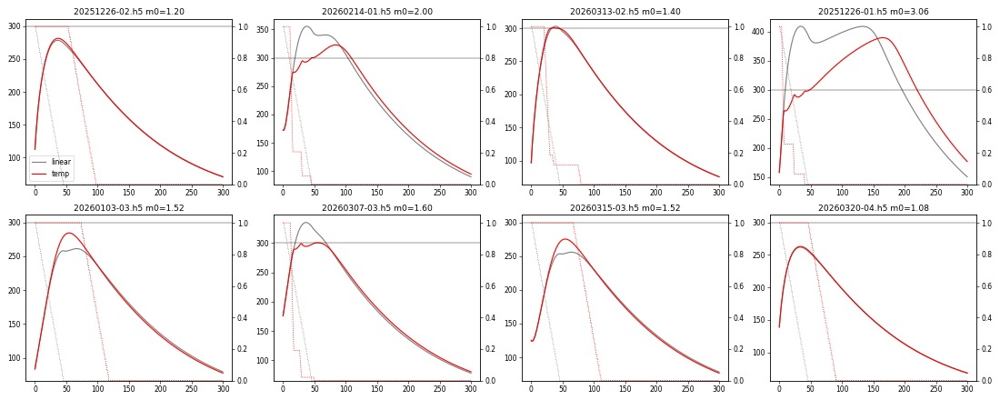

# Temperature Target Mode (`temp_control`)

A second automatic operating mode next to `timed_close` (formerly `vent_closer`). Instead of closing the air vent along a
fixed line over `VENT_CLOSE_TIME`, it watches the max temperature of the glass-door thermal frame:

1. **Flaming stage:** close the vent as fast as the fire allows while holding the temperature at
   a target (default 300°C). Back off if the closing starves the fire.
2. **Coal stage:** once the wood has burned down, close at the linear closer rate to minimize
   chimney heat loss and make the coals last.
3. **Can't reach target:** raise a **Fire Stalled** flag for an HA notification and close at the
   linear closer rate.

The aim is robustness across load sizes and wood types without manual intervention, rather than
a large efficiency gain.

Code: `temperature_target.py` (controller), wired in `code.py`, `homeassistant.py`,
`thermal_camera.py`, `vent_closer.py`. Offline tools: `simulation/`.

## Combustion background

- Wood burns in two stages. First the wood releases volatile gases that burn as flames; these
  carry a large share of the energy and burn cleanly only when hot (roughly 600°C / 1100°F or
  more) and with enough oxygen. Starving this stage gives smoke, CO and creosote, and can stall
  the fire.
- Then the remaining charcoal glows. Its burn rate is set almost entirely by the air supply.
- Air beyond what combustion needs is heated and sent up the chimney (*excess air*, the main
  heat-transfer loss). So in the **flaming stage** the goal is the least air that keeps the fire
  hot (the target temperature). In the **coal stage** the goal is simply the least air: that both
  cuts chimney loss and slows the coals' burn.
- An EPA non-cat stove's secondary air isn't controlled by the vent, and "closed" still leaks some
  primary air, so the vent trims the fire but never shuts it off.

## What the recorded data says (≈270 burn cycles, Dec 2025 – Oct 2026)

| Finding | Value | Design consequence |
|---|---|---|
| Max-pixel noise per 10 s sample | median 0.15°C, 10% of burns > 1.6°C, 1% > 3.3°C | Smoothing plus a noise band; must tolerate ~3°C |
| Chessboard (subpage) artifact frames | ≈1 per burn | Reject on-device before control |
| Response to a manual vent opening | dead time 2–3 min, 63% response in 6–10 min | Predict ahead; act on trends, not samples |
| After full close, T keeps rising | often +30–60°C | Start closing *before* the target |
| Closing a young fire too early | 114 manual interventions in 68 burns | Ignition phase; back off when closing starves the fire |
| Many loads peak below 300°C | about half of burns | Need an explicit "can't reach target" outcome |

### When have the reloaded logs caught?

Across 184 reloads, you closed the vent ≥15% within 5 minutes in 58% of them (median 101 s, to
about 25% closed). A fixed hold time can't follow that. Neither the starting glass temperature nor
the first minutes' heating rate predicted a stall. But the rise above the post-reload low did:

| First closing step came… | Reloads | Needed a manual rescue |
|---|---|---|
| before a 40°C rise above the post-reload low | 144 | 13% |
| after it | 31 | 3% |

The post-reload low comes about 1.4 min after reloading and is only ~2°C below the reload
temperature. The 40°C rise follows at a median of 7 min (25–75%: 5–10 min), never in 5% of
reloads. The glass lags the fire, so the camera can't confirm ignition sooner than about 4–5 min
even with ample coals. An earlier manual close is accepted, and a sag after it gets a back-off.

### Stall vs coal stage

Both look like "temperature falling below target", but need opposite responses (more air vs
less). Compared across your manual rescues and ≈2,600 samples of normal coal-stage cooling:

| | Stall (you re-opened) | Coal-stage cooling |
|---|---|---|
| Cooling rate | −1.5°C/min | −1.2°C/min |
| Hot region position/size on the glass | same | same |
| **Time since the vent last closed a step** | **2 min** median (75% < 18 min) | **87 min** median (75% > 55 min) |
| **Drop from the burn's peak** | **26°C** median | **110°C** median |

The camera can't tell flames from coals through the glass. What separates them is cause and
effect: a stall follows a closing step within minutes, while coal-stage cooling happens long after
the vent stopped moving. The controller uses exactly that.

## Control law

Runs once per accepted camera frame (≈10 s). Position `u`: 0 = open, 1 = closed (as `Vent`).

**Signal conditioning.**
- Reject chessboard frames (`subpage_mismatch > THERMAL_SUBPAGE_THRESHOLD`) and single-sample
  jumps > `TT_SPIKE_THRESHOLD` (door opened). A jump that persists for 3 samples is accepted.
- Exponential smoothing (`TT_FILTER_TIME`).
- A fast slope over `TT_SLOPE_WINDOW` for prediction, and a slower trend over `TT_TREND_WINDOW`
  for rising/falling decisions.
- Prediction: `T_pred = T + TT_HORIZON · slope`.

**Phases** (shown in HA as Controller Phase):

| Phase | Entered when | Vent |
|---|---|---|
| `ignition` | Reload (vent opened fully) | Hold until the logs have caught: `TT_IGNITION_RISE` above the post-reload low (capped at `TT_IGNITION_LOW_CAP`), or level within `TT_MARGIN` of target |
| `regulate` | Ignition complete | Optional close to `TT_EARLY_POSITION`; then close-only PI on `T_pred − target`, pausing below target |
| `recovering` | Below `target − TT_MARGIN` and falling for `TT_CONFIRM_TIME`, within `TT_STALL_WINDOW` of a closing step (the controller's or yours) | Back off: re-open to where the vent was `TT_STALL_WINDOW` ago, at most `TT_BACKOFF_LIMIT`; wait up to `TT_RECOVERY_TIME` |
| `stalled` (**Fire Stalled** ON) | Logs haven't caught by `TT_STALL_MIN_TIME` and the temperature is level or falling; or the fire peaked and is falling without ever getting within `TT_MARGIN` of target; or starved again after `TT_MAX_RESCUES` back-offs | Close at the linear rate |
| `coals` | Target reached, then below `target − TT_MARGIN` and falling with no closing step for `TT_STALL_WINDOW`; or a back-off didn't help | Close at the linear rate; never re-open |

What happens next:

- From `recovering`, if the temperature rises again, the controller goes back to `regulate`.
  If more air doesn't help, the fire is fuel-limited, not starved: it goes to `coals` if the
  target was reached, otherwise `stalled`.
- From `stalled`, if the fire recovers, it goes back to `regulate`. Recovery means rising for
  `TT_CONFIRM_TIME`, and either `TT_STALL_RECOVERY_RISE` above its low while stalled or within
  `TT_MARGIN` of target (e.g. after adjusting the logs or adding kindling). Below target,
  `regulate` holds the vent, so the recovery isn't closed off. Closing steps made while stalled are
  kept, so a relapse soon after gets a back-off, and a relapse with no response returns to
  `stalled`.
- A reload is always signalled by opening the vent fully. A partial opening only adjusts airflow
  for the existing logs and doesn't restart the burn.

**Linear rate.** The remaining open fraction closes over that fraction of the HA Closing Duration:
the same slope as the linear closer, which now sets this rate in both modes.

**Close-only PI controller.** Velocity form: `du = Kp·Δe + Ki·e·dt`, limited to
`TT_MAX_CLOSE_RATE`. Its internal output may sit up to `TT_NOISE_BAND` below the vent without
re-opening it. Otherwise the clipping of downward moves would turn symmetric sensor noise into a
steady closing drift.

**Manual moves** go through the existing `Override` / `MoveVentState` paths:
- Opening to < 10% open counts as a reload and restarts ignition.
- Any other move continues from the new position. Closing by hand counts as a closing step when
  attributing a later drop.

**Sensor loss.**
- No valid sample for `TT_STALE_TIMEOUT`: the vent is held and a warning logged.
- After `TT_STALE_FALLBACK_TIME`, it closes at the linear rate, like `timed_close`, until samples
  return. This avoids holding e.g. a fully open vent on a fresh load while the camera is out.
- After any gap, a single control update acts on at most 30 s, so a blocked main loop doesn't
  release a minute's worth of closing at once.

**Logging.** Every phase change and controller action (reload, early close, back-off, manual
move) writes one INFO line from the `temperature_target` logger to the MQTT log and file log:

```
temp_control regulate -> recovering: starved by closing, back-off 0.850 -> 0.600 | t=1930
  phase=recovering T=268.4 pred=241.0 trend=-1.9/min peak=301.2 low=142.0 target=300 reached=1
  vent=0.600 since_close=140 rescues=1
```

(Shown wrapped here; it is a single line in the log.)

`t` is seconds since the reload, the same clock as the StoveLink `combustion_time` stored in each
HDF5 frame. Log lines can be matched to frames without relying on wall-clock time.

The controller reuses `VentCloser` and its Monitoring/Closing/Override/Closed sub-states
unchanged; `TemperatureTargetFunction` replaces `LinearVentFunction`.

## Using it

- HA "State Machine" select options are now `idle`, `timed_close` and `temp_control`.
  MQTT `<topic>/command` accepts the same names; `vent_closer` and `close` still work as aliases
  for `timed_close`.
- `AUTO_MODE = "temp_control"` in `settings.toml` makes Idle engage this mode on the
  closed→open reload gesture (default stays `timed_close`).
- **Closing Duration** (existing number) now sets the linear rate for both modes.
- New entities:
  - **Target Temperature** (number, 150–400°C)
  - **Fire Stalled** (binary sensor, problem class)
  - **Controller Phase** and **Predicted Max Temperature** (diagnostic sensors)
- Notification automations:
  - **Fire Stalled → on**: the load can't reach target.
  - **Controller Phase → `coals`**: optional "reload now?" reminder.

### Settings (`settings.toml`, all optional)

| Key | Default | Meaning |
|---|---|---|
| `TT_TARGET` | 300 | Target max glass temperature, °C |
| `TT_MARGIN` | 25 | °C below target that counts as "not at target" |
| `TT_KP` | 0.01 | Vent fraction per °C change in predicted error |
| `TT_KI` | 0.006 | Vent fraction per °C of predicted error per minute |
| `TT_HORIZON` | 450 | Prediction horizon, s |
| `TT_FILTER_TIME` | 60 | Smoothing time constant, s |
| `TT_SLOPE_WINDOW` | 120 | Prediction slope window, s |
| `TT_TREND_WINDOW` | 300 | Rising/falling decision window, s |
| `TT_PLATEAU_SLOPE` | 0.5 | °C/min: slower counts as flat |
| `TT_CONFIRM_TIME` | 120 | A decline/plateau must persist this long, s |
| `TT_MAX_CLOSE_RATE` | 0.2 | Max closing speed while regulating, fraction/min |
| `TT_NOISE_BAND` | 0.1 | PI output slack below the vent position |
| `TT_IGNITION_RISE` | 40 | °C above the post-reload low that marks the logs as caught |
| `TT_IGNITION_LOW_CAP` | 150 | Cap on that low, so a hot-stove start or mid-burn restart isn't stuck (caught by 190°C) |
| `TT_EARLY_POSITION` | 0 (off) | Partial close when ignition completes; 0.25 matches your manual habit |
| `TT_STALL_MIN_TIME` | 900 | Earliest "logs haven't caught" stall, s |
| `TT_STALL_RECOVERY_RISE` | 20 | °C above the low while stalled, rising, to regulate again |
| `TT_STALL_WINDOW` | 1200 | Decline within this long of a closing step is a stall, s |
| `TT_BACKOFF_LIMIT` | 0.25 | Max re-opening per back-off |
| `TT_RECOVERY_TIME` | 600 | Time for the fire to respond to a back-off, s |
| `TT_MAX_RESCUES` | 2 | Back-offs per burn before declaring a stall |
| `TT_SPIKE_THRESHOLD` | 60 | Outlier rejection, °C |
| `TT_STALE_TIMEOUT` | 120 | Hold the vent if no samples for this long, s |
| `TT_STALE_FALLBACK_TIME` | 300 | Then close at the linear rate until samples return, s |
| `THERMAL_SUBPAGE_THRESHOLD` | 10 | Chessboard frame rejection, °C |
| `AUTO_MODE` | timed_close | Mode engaged by the reload gesture (`vent_closer` still accepted) |

## Validation

### Replay of recorded burns (`simulation/replay_stalls.py fair`)

The recorded temperatures go through the real classifier. Recorded closing steps count only where
the controller itself would have closed (predicted temperature at or above target).

**Burns you left alone after the peak (116):**
- 90 classified as coal stage.
- 17 flagged Fire Stalled. 8 were not real fires (peaks of 30–64°C) and 6 were weak loads that
  peaked at 200–272°C. 3 were flagged early (peaks 280–320°C); the linear closer was choking
  those, and the flag clears if the fire climbs back near target.
- 8 got a back-off; those that had reached target resolve to coal stage.
- 1 never declined clearly.

So Fire Stalled fires for weak loads and essentially never on a normal burn.

**Your manual rescues of a sagging fire (18 first rescues):**
- Where the controller's logic applies, it backed off a median 15 minutes before you did.
- The 8 it missed were young fires (8–26 min, < 280°C) that the linear closer choked.
  temp_control would still be holding them open in ignition.

### Closed-loop simulation (`simulation/final.py`)

Two grey-box stove models were fitted to 90 burns:
- **v2:** fuel-dominated and slow (median error 8°C).
- **v3:** air- and fuel-limited burn rate plus a fast flame term (median error 12°C).

Neither is right on its own; they bracket the behavior. Results are means over all burns and
parameter variants, with a 60 s extra actuator delay:

| | Linear v2 | Temp target v2 | Linear v3 | Temp target v3 |
|---|---|---|---|---|
| Time within 15°C of / above target | 39 min | **51 min** | 38 min | **46 min** |
| Time > target + 40°C | 14 min | **13 min** | 16 min | **10 min** |
| Time < 200°C with > 30% fuel left (starved) | 32 min | **20 min** | 23 min | **22 min** |
| Mean air while burning (lower is better) | **0.58** | 0.64 | **0.33** | 0.37 |
| Burns flagged Fire Stalled | n/a | 8% | n/a | 25% |

Ending ignition on the 40°C rise gives the same results as the earlier fixed 10-minute hold.
Adding `TT_EARLY_POSITION=0.25` saves 3–5% air but costs 1–4.5 min at target and gives more stall
flags in the models. The models don't know the coal bed, though, so it's left for you to try.

The controller spends more time at target, starves the fire less and overshoots less. It uses a
few percent more air, mostly because the coal stage now closes at the linear rate instead of
already being closed. **Noise robustness:** at 0.5, 3 and 8°C sensor noise, time at target is
45, 45 and 43 min, with no extra false stall flags.



Gray = linear closer, red = temperature target; solid = max temp, dotted = fraction open.

## First-burn test plan

1. Keep `AUTO_MODE = timed_close`; select `temp_control` manually from HA after a reload.
2. Watch Controller Phase, Fire Stalled, Predicted Max Temperature, Thermal Max and Air Vent.
   Expected sequence:
   - `ignition` until the glass has risen 40°C above its post-reload low (typically 5–10 min);
   - a staircase of closing steps once the prediction crosses 300°C, with pauses on dips;
   - `coals` with a steady linear close.
3. Create the HA notification automation on Fire Stalled.
4. Match the `temp_control` log lines to the HDF5 frames by `t` = `combustion_time`.
5. Refit and re-tune from new StoveLink cycles with `simulation/fit.py` and `tune.py`, and
   re-check the classifier with `replay_stalls.py`.

## Caveats / open items

- **Sensor limit:** the MLX90640's rated object range ends at 300°C. Readings reach ~400°C, but
  above 300 they are outside spec. Don't raise `TT_TARGET` without that in mind.
- **Glass soot:** at low air the glass can soot up and read as cooling. Check the thermal images
  of early burns.
- **Small loads** behave much like the linear closer (with a notification). Adopting the peak a
  load actually reached as its target is a possible future refinement.
- **Coal stage and CO:** at low air the coals produce CO. A sealed stove with working draft sends
  it up the chimney, but keep a CO detector in the room as usual.
- **Logging:** controller internals aren't in the StoveLink packet. Adding the phase to the
  reserved header field would make analysis of real burns easier.
